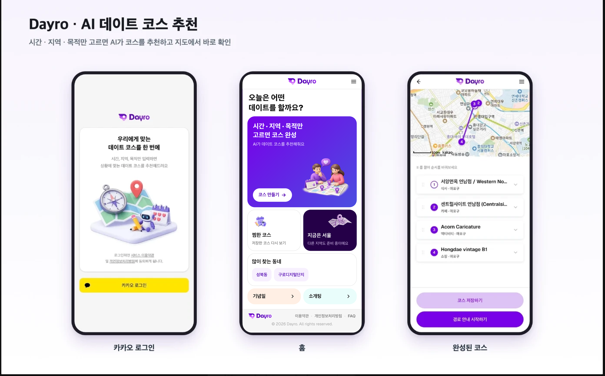
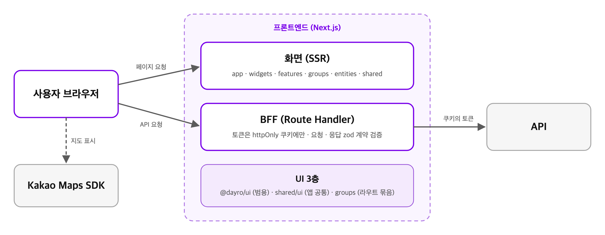

<div align="center">

# 💘 Dayro

**시간 · 지역 · 목적만 고르면, AI가 오늘의 데이트 코스를 짜주는 웹 서비스**

Google Places로 주변 장소 후보를 모으고 Gemini가 상황에 맞게 골라 순서대로 엮어, 지도와 길찾기까지 한 번에 보여줍니다.

<br>

[🌐 day-ro.com](https://day-ro.com) · [📷 Instagram @dayro_app](https://www.instagram.com/dayro_app/)

<br>


<br><br>



</div>

> [!NOTE]
> 팀 저장소의 **현재 코드를 공개용으로 정리한 스냅샷**입니다. 코드를 읽어보는 용도이며, 그대로 실행되지 않습니다.
> 커밋 히스토리 · 운영 설정 · 테스트 코드는 빠져 있고, 코드 안의 주소 · 이메일은 `example.invalid` 로 바꿔 두었습니다.

---

## 📑 목차

[프로젝트 현황](#-프로젝트-현황) · [핵심 기능](#-핵심-기능) · [기획 배경](#-기획-배경) · [기능별 배경](#-기능별-배경) · [현재 이슈](#-현재-이슈) · [시스템 구조](#️-시스템-구조) · [기술 스택](#-기술-스택) · [폴더 구조](#-폴더-구조)

---

## 📊 프로젝트 현황

<sup>업데이트: **2026-11-05**</sup>

> **2026.11 ~ 베타 테스트 중** — [day-ro.com](https://day-ro.com)에서 `상황 입력 → AI 코스 생성 · 재추천 → 지도 · 길찾기 → 저장 · 공유` 전 구간 동작

| 영역 | 내용 |
| --- | --- |
| 🏷️ 버전 | `1.0.0-rc.6` |
| 🔗 머지된 PR | **214개** (FE · BE) |
| 🧪 FE 테스트 | 단위 **1,161개** (Vitest) · e2e **128개** (Playwright) |
| 👥 팀 | 4인 · 프론트엔드 담당 |

### 기능별 상태

| 기능 | 상태 |
| --- | --- |
| 카카오 로그인 · 회원 · 탈퇴 | ✅ 완료 |
| 둘러보기 · 카카오 로그인 전 만 14세 확인 | ✅ 프론트 완료 · 백엔드 저장 준비 중 |
| 상황 입력 3단계 | ✅ 완료 |
| AI 코스 생성 · 다른 코스 보기 | ✅ 완료 |
| 코스 결과 · 지도 · 네이버 길찾기 | ✅ 완료 |
| 코스 저장 · 수정 · 삭제 · 공유 | ✅ 완료 |
| 벤토 그리드 홈 · 목적 바로가기 | ✅ 완료 |
| 마이페이지 · FAQ · 약관 | ✅ 완료 |
| AI 에이전트 협업 하네스 | ✅ 완료 |

---

## ✨ 핵심 기능

1. **상황 입력** — 시간대 · 지역(시 · 구 · 동 검색) · 목적 3단계 선택, 생성 대기 중 초성 퀴즈 제공
2. **AI 코스 생성** — Google Places 후보 중 Gemini가 장소를 골라 순서대로 구성, 마음에 안 들면 다른 코스 보기
3. **지도 · 길찾기** — 카카오맵에 코스 동선 표시, 장소 순서를 끌어서 변경, 네이버 길찾기(경유지 포함)로 바로 연결
4. **저장 · 공유** — 코스 저장 · 설명 수정 · 삭제, 카카오톡 미리보기 카드로 공유
5. **로그인 복귀** — 상황 입력 중 로그아웃해도 다시 로그인하면 그 단계로 복귀
6. **홈 바로가기** — 기념일 · 소개팅을 누르면 상황 입력에 미리 선택, 언제든 변경 가능

---

## 💡 기획 배경

- **문제** — 데이트 장소를 고를 때 지도 앱 · SNS · 블로그를 오가며 검색하고, 고른 장소들을 동선에 맞게 다시 엮어야 함
- **목표** — 시간대 · 지역 · 목적 세 가지만 고르면 AI가 장소 선택부터 방문 순서 · 길찾기까지 한 번에 제안
- **대상** — 만 14세 이상, 오늘 데이트 계획을 빠르게 정하고 싶은 사용자
- **방향** — 로그인 없이 둘러보기로 먼저 써보고, 마음에 드는 코스는 카카오 로그인 후 저장 · 공유

---

## 🧩 기능별 배경

- **상황 입력 3단계** — 질문이 많으면 이탈이 늘어 시간대 · 지역 · 목적 세 가지로 줄임, 생성 대기 시간이 지루하지 않게 초성 퀴즈 제공
- **AI 코스 생성 · 다른 코스 보기** — 후보 장소는 Google Places 실데이터로 모으고 Gemini는 고르기 · 순서 정하기만 맡겨 없는 장소 추천을 막음
- **장소 정보 보기** — 이름만으로는 고르기 어려워 사진 · 영업시간을 미리 확인, PC는 마우스 미리보기 · 모바일은 ⓘ 버튼
- **지도 · 길찾기** — 코스를 받아도 이동 경로를 다시 찾아야 하는 불편을 줄이려고 카카오맵 동선 + 네이버 길찾기(경유지 포함) 연결
- **저장 · 공유** — 데이트 상대에게 바로 보낼 수 있게 카카오톡 미리보기 카드로 공유
- **로그인 복귀** — 입력 중 로그아웃 · 재로그인해도 하던 단계로 돌아가 다시 입력하지 않게 함
- **홈 바로가기** — 기념일 · 소개팅처럼 목적이 정해진 사용자는 한 단계를 건너뛰게 미리 선택

---

## 🚧 현재 이슈

- **만 14세 미만 이용 제한** — 둘러보기 · 카카오 로그인 전에 만 14세 이상인지 확인, 미만이면 이용 불가 안내 (프론트 완료 · 백엔드 확인 기록 저장 준비 중)

---

## 🏗️ 시스템 구조

> 브라우저는 Next.js(BFF)만 호출하고, BFF가 쿠키 속 토큰으로 Spring Boot를 대신 호출합니다.

<p align="center"></p>

**프론트엔드 레이어** — 기능별로 잘라 나눈 Vertical Slice Architecture

<p align="center"></p>

---

## 🧱 기술 스택

| 구분 | 기술 | 역할 |
| --- | --- | --- |
| 프론트엔드 | Next.js 16 (App Router) · React 19 · TypeScript | SSR 화면 + BFF Route Handler |
| 스타일 | Tailwind CSS 4 · CSS Modules | `@theme` 디자인 토큰 + 도메인별 CSS Module |
| 검증 | Zod (`zod/mini`) | BFF ↔ 백엔드 요청 · 응답 런타임 검증 |
| 지도 | Kakao Maps JavaScript SDK | 코스 동선 표시 |
| 드래그 | dnd-kit | 확정 코스 장소 순서 변경 |
| 테스트 | Vitest · Playwright · Storybook · MSW | 단위 · e2e · UI 카탈로그 · API 목 |
| 백엔드 | Spring Boot 3.5 · Java 21 · Spring Security(JWT) | 인증 · 코스 · 저장 API |
| AI | Spring AI 1.1 · Google Gemini | 장소 후보 선별 · 코스 구성 |
| 장소 데이터 | Google Places API | 지역별 장소 후보 수집 |
| 데이터 | PostgreSQL + pgvector · Redis | 회원 · 코스 저장 · 캐시 |

---

## 📁 폴더 구조

```text
frontend/src
├── app        # 라우트 · BFF Route Handler
├── widgets    # 화면 조합
├── features   # 기능 단위 조각 · 규칙
├── entities   # 도메인 모델
└── shared     # 공용 UI · API 계약 · 유틸

backend/dayro-backend/src/main/java/com/dayro
├── auth       # 로그인 · 회원
├── situation  # 상황 입력 · 코스 추천
├── course     # 코스 저장 · 공유
├── inquiry    # 문의
├── activity   # 활동 기록
└── global     # 설정 · 예외 · 공통 응답
```

---

<div align="center">
<sub>🤖 프론트엔드는 Claude Code · Codex 두 AI가 같은 규칙으로 역할을 나눠 협업하는 <b>에이전틱 엔지니어링</b> 방식으로 개발했습니다.</sub>
</div>
